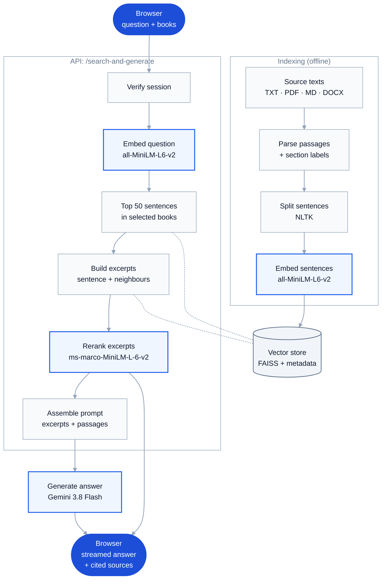

# PhiloSearch

A semantic search and RAG (Retrieval-Augmented Generation) platform for philosophical texts, featuring a Vite + React frontend and FastAPI backend with 2-stage retrieval and AI-powered answers.

<picture>
  <source media="(prefers-color-scheme: dark)" srcset="docs/screenshot-dark.png">
  
</picture>

## Features

- 🔍 **Semantic Search**: Sentence embeddings with all-MiniLM-L6-v2 (384-dim)
- 📚 **Book Selection**: Choose which works to search from the Library panel
- 🎯 **2-Stage Retrieval**: Parent-child FAISS + cross-encoder reranking (nDCG@10 +27.7% over flat search, 88% vs 50% accuracy@1)
- 🤖 **RAG Generation**: Gemini 3.8 Flash streaming answers with source citations
- 📄 **Multi-format Support**: PDF, TXT, MD, DOCX
- ⚡ **Ray Distributed Processing**: 3.80x faster embedding and indexing than single-threaded CPU (10 workers, excluding their ~6.5s startup)
- 📌 **Structured Citations**: Short 1–3 sentence excerpts labelled by book and section (e.g. "Meditations, Book 6, §49")
- 🚀 **Automatic Device Detection**: MPS/CUDA/CPU
- 🌓 **Light and Dark Themes**: Follows the system setting, with a toggle in the header

## Architecture



## Tech Stack

- **Frontend**: Vite, React 19, TypeScript, Tailwind CSS v4
- **Backend**: FastAPI, Python
- **Vector Store**: FAISS with persistent storage
- **AI/ML**:
  - Embeddings: all-MiniLM-L6-v2 (384-dim, bi-encoder)
  - Reranker: cross-encoder/ms-marco-MiniLM-L-6-v2
  - Generation: Gemini 3.8 Flash (1M token context, streaming), falling back to Gemini 3.6 Flash and then Gemini 3.5 Flash when a model is overloaded (503), rate-limited or out of quota (429), unavailable (404), or the connection drops
- **Distributed Processing**: Ray

---

## Quick Start

### Prerequisites

- Node.js 20.19+ or 22.12+ (required by Vite 7)
- Python 3.10+
- A Google AI Studio API key (for Gemini): https://aistudio.google.com/apikey

### 1. Clone & Install

```bash
git clone https://github.com/jessecui/philosearch.git
cd philosearch

# Frontend dependencies
cd frontend
npm install
cd ..

# Backend dependencies
cd backend
pip install -r requirements.txt
```

### 2. Configure Environment

Copy `backend/.env.example` to `backend/.env` and fill it in:

```bash
GEMINI_API_KEY=your-google-ai-api-key   # Gemini (the older name GOOGLE_API_KEY also works)
CREATOR_NAME=your-name                  # the name the access prompt asks for
# Optional:
# AUTH_SECRET=...            # signs session cookies (derived from the two above if unset)
# ADMIN_TOKEN=...            # enables upload/delete endpoints (disabled if unset)
# MAX_UPLOAD_MB=50           # upload size limit for those endpoints, per file (MiB)
# ENABLE_RAY=true            # enables /index-distributed
```

### 3. Index the Texts

Neither the texts nor the index are committed. Add the texts to `backend/texts/` under the filenames listed in [Texts](#texts), then build the FAISS vector store:

```bash
# From backend/ directory
python -m app.scripts.index_texts
```

This will generate `backend/data/faiss.index` and `backend/data/metadata.json`. The new index is built in a staging folder and only replaces the old one if every file indexes successfully. Restart the server afterwards so it loads the new index.

### 4. Run the Application

```bash
# Terminal 1: Start backend (from backend/)
uvicorn app.main:app --reload
# API at http://localhost:8000

# Terminal 2: Start frontend (from frontend/)
npm run dev
# App at http://localhost:5173
```

In development the frontend calls the API through Vite's `/api` proxy (see `frontend/vite.config.ts`). In production, build the frontend (`npm run build`) and the backend serves it from `frontend/dist`. The frontend and API must share an origin: the session cookie is `SameSite=Lax`, so a frontend hosted on a separate domain cannot authenticate. `VITE_API_URL` is only for a same-site path such as a reverse-proxy prefix.

---

## API Endpoints

| Endpoint | Method | Access | Description |
|----------|--------|--------|-------------|
| `/` | GET | Public | Serves the built frontend (or a health message if `frontend/dist` is missing) |
| `/health` | GET | Public | Health check |
| `/login` | POST | Public | Checks the access answer; on success sets the `philosearch_session` cookie (401 if wrong, 429 after too many wrong answers) |
| `/me` | GET | Public | Whether the request carries a valid session: `{"signed_in": true}` |
| `/search` | POST | Session | Semantic search with optional reranking |
| `/search-and-generate` | POST | Session | RAG: retrieve and stream a generated answer |
| `/generate` | POST | Session | Stream an answer from results returned by `/search` |
| `/documents` | GET | Public | List indexed documents |
| `/stats` | GET | Public | Vector store statistics |
| `/index` | POST | Admin | Index an uploaded document |
| `/index-distributed` | POST | Admin | Index an uploaded document with Ray (`ENABLE_RAY=true`) |
| `/embed` | POST | Admin | Return sentence embeddings for an uploaded document |
| `/documents/{doc_id}` | DELETE | Admin | Remove a document |

**Session:** an HttpOnly, signed cookie issued by `/login`, valid for 24 hours. **Admin:** send `X-Admin-Token: <ADMIN_TOKEN>`; these endpoints return 403 when `ADMIN_TOKEN` is not set.

### Search Parameters (`/search`)

- `query` (required): Search text
- `use_reranking` (default: false): Enable 2-stage retrieval
- `top_k` (default: 5, max 50): Results to return
- `top_k_faiss` (default: 50, max 200): FAISS sentence candidates for reranking
- `context_window` (default: 2): Paragraphs before/after to include in each result (only with `use_reranking: true`)
- `doc_ids` (optional): Only search these documents (ids from `GET /documents`); omit to search all. Unknown ids return 404 "Some selected books are no longer indexed."; an empty list returns 404 "Select at least one book to search."

### Generation Parameters (`/search-and-generate`)

- `query` (required)
- `top_k_context` (default: 5, max 20): Passages to cite (the web app uses 10)
- `use_reranking` (default: true), `top_k_faiss` (default: 50)
- `temperature` (default: 0.7), `max_output_tokens` (default: 8192, max 8192)
- `doc_ids` (optional): Only search these documents. The web app sends the books ticked in its Library panel, and omits the field when every book is ticked. Unknown ids return 404 "Some selected books are no longer indexed."; an empty list returns 404 "Select at least one book to search."

---

## Usage Examples

### Index a Document

```bash
curl -X POST "http://localhost:8000/index" \
  -H "X-Admin-Token: $ADMIN_TOKEN" \
  -F "file=@document.pdf"
```

### Sign in

`/search`, `/generate` and `/search-and-generate` need a session cookie:

```bash
curl -c cookies.txt -X POST "http://localhost:8000/login" \
  -H "Content-Type: application/json" -d '{"answer": "your-name"}'
```

### Search with Reranking

```bash
curl -b cookies.txt -X POST "http://localhost:8000/search" \
  -H "Content-Type: application/json" \
  -d '{
    "query": "what is consciousness?",
    "use_reranking": true,
    "top_k": 10
  }'
```

### RAG: Search & Generate Answer

```bash
# Stream an answer (with the session cookie from "Sign in" above)
curl -N -b cookies.txt -X POST "http://localhost:8000/search-and-generate" \
  -H "Content-Type: application/json" \
  -d '{
    "query": "What is the nature of the Tao?",
    "top_k_context": 5
  }'
```

### Test Scripts

```bash
# Test retrieval pipeline
python -m app.scripts.test_search "What does the Tao say about water?"

# Test RAG pipeline with pretty output
python -m app.scripts.test_search_and_generate "How should one cultivate virtue?"
```

---

## RAG Response Format

Server-Sent Events (SSE) streaming:

```
// Initial: Retrieved sources
data: {"type":"sources","data":[{"filename":"Tao_Te_Ching__Lao_Tzu.txt","author":"Lao Tzu","paragraph_idx":7,"section_label":"Chapter 8","excerpt":"The supreme good is like water, ...","text":"<full passage>","score":0.97}]}

// Streaming: Tokens as they're generated
data: {"type":"token","data":"The "}
data: {"type":"token","data":"Tao "}

// Final: Timing metrics (/generate reports only generation_time and total_time)
data: {"type":"done","data":{"embedding_time":0.01,"faiss_time":0.002,"reranking_time":0.13,"retrieval_time":0.14,"generation_time":2.34,"total_time":2.52}}

// On failure, instead of "done"
data: {"type":"error","data":{"message":"...","code":"generation_error"}}
```

---

## Performance Benchmarks

### Retrieval Quality

Tested on 50 queries with graded relevance labels over a synthetic 100-paragraph document: 50 closely related utilitarianism variants (the query targets) plus 50 paragraphs on neighbouring topics such as deontology, Kant and Stoicism as distractors:

| Metric | Flat search | Parent-child FAISS | Parent-child + Reranking | vs Flat | vs Parent-child |
|--------|------------|--------------------|--------------------------|---------|-----------------|
| **Accuracy@1** | 50% | 62% | 88% | **+38pp** | **+26pp** |
| **nDCG@10** | 0.704 | 0.760 | 0.899 | **+27.7%** | **+18.4%** |
| **MRR** | 0.659 | 0.740 | 0.929 | **+40.9%** | **+25.5%** |

Reranking adds roughly 90 ms per query on Apple MPS in this eval (see the "Reranked … excerpts in …s" lines in `eval_faiss_cross_encoder_ndcg_output.txt`) (about 0.05–0.5 s on the full corpus, depending on how many candidate excerpts are scored).

### When to Use Reranking

**Use `use_reranking=true` for:**
- User-facing search (quality critical)
- Top-k precision requirements
- Query time up to ~0.5 s acceptable

**Use `use_reranking=false` for:**
- Real-time applications (tens of milliseconds)
- Broad recall needed
- Resource-constrained environments

### Ray Distributed Processing

Embedding and indexing 19,900 sentences with all-MiniLM-L6-v2 on a 12-core Mac (CPU unless noted; the single-threaded and Ray times include about 0.3s of FAISS indexing):

| Method | Time | Throughput | vs single-threaded |
|--------|------|------------|--------------------|
| **Single-threaded CPU** (benchmark baseline) | 28.26s | 704 sent/s | 1.0x |
| **Multithreaded CPU** (PyTorch default, no Ray) | 11.55s | 1,723 sent/s | 2.4x |
| **Ray, 10 CPU workers** (excluding 6.5s worker startup) | 7.43s | 2,679 sent/s | **3.80x** (−73.7% latency) |
| **Ray, 10 CPU workers** (including startup) | 13.94s | 1,428 sent/s | 2.03x (−50.7% latency) |
| **Apple GPU (MPS), no Ray** | 5.80s | 3,431 sent/s | 4.9x |

The Ray rows are from run 3 of three, the run with the median latency reduction (73.8%, 73.6%, 73.7%; all three are in `test_outputs/eval_ray_ingestion_latency_output.txt`); results vary by about ±1 point between runs. The single-threaded baseline is warmed up before timing, like the Ray workers. Ray pays off for large CPU-only batches once its workers are running; on a machine with a GPU, a single GPU process is faster. The multithreaded CPU and MPS rows were measured separately on the same input; `eval_ray_ingestion_latency` reports the single-threaded and Ray rows.

The table above counts Ray's startup separately. Counting startup for every method, and comparing against PyTorch's own multithreading, shows how large a job has to be before Ray pays off (`eval_embedding_at_scale`, sentences from the library repeated to each size). Both sides use the same 8 cores: PyTorch's default runs 8 threads (one per performance core on the M4 Pro), and each of Ray's 8 workers runs a single thread.

| Sentences | Single-threaded CPU | PyTorch default multithreading (8 threads) | Ray, 8 CPU workers | Ray vs PyTorch default | Ray vs single-threaded |
|-----------|--------------------|-------------------------------------------|--------------------|------------------------|------------------------|
| 20,000 | 36.2s | 16.4s | 16.3s | 1.00x (−0.5% latency) | 2.23x (−55.1%) |
| 300,000 | 491.5s | 223.5s | 147.8s | **1.51x (−33.9% latency)** | **3.32x (−69.9%)** |

Ray's ~6s worker startup cancels its speed advantage around 20,000 sentences; by 300,000 it is under 4% of the run. Once running, Ray's workers embed about 56% more sentences per second than PyTorch's threads on the same cores at 300,000 sentences (about 38% at 20,000), because each worker processes its own batches instead of splitting every batch across threads. Earlier runs at 300,000 sentences gave 31.8%–35.0% against PyTorch's default, so expect a few points of variation. Adding workers beyond 8 doesn't help: 10 workers ran no faster, since the extra two land on efficiency cores.

`/index-distributed` also runs 8 workers. **Recommendation:** Use `/index-distributed` for CPU-only batches of tens of thousands of sentences or more. Below that, the regular indexing path, which uses PyTorch's multithreading or the GPU, is as fast or faster.

### Run Evaluations

```bash
# Test retrieval quality (flat vs parent-child vs parent-child + reranking)
python -m app.evaluation.eval_faiss_cross_encoder_ndcg

# Test ingestion performance (sequential vs Ray distributed)
python -m app.evaluation.eval_ray_ingestion_latency

# Test embedding at scale (single-threaded vs PyTorch threads vs Ray, startup included)
python -m app.evaluation.eval_embedding_at_scale
```

---

## Project Structure

```
philosearch/
├── frontend/                           # Vite + React frontend
│   ├── src/
│   │   ├── App.tsx                     # Search interface, answer and sources
│   │   ├── main.tsx                    # Entry point
│   │   ├── index.css                   # Global styles
│   │   ├── components/
│   │   │   ├── auth-modal.tsx          # Access prompt
│   │   │   ├── library-panel.tsx       # Book picker (which books to search)
│   │   │   ├── book-cover.tsx          # Generated book covers
│   │   │   ├── logo-mark.tsx           # Header logo (same drawing as the favicon)
│   │   │   └── ui/                     # UI components
│   │   └── lib/
│   │       ├── answer-format.ts        # Renders the answer's Markdown
│   │       ├── books.ts                # Book titles, dates, cover colours, section labels
│   │       ├── api.ts                  # API base URL and error helper
│   │       ├── theme.ts                # Light/dark theme (system setting + toggle)
│   │       └── utils.ts                # Utility functions
│   ├── index.html                      # Page shell (sets the theme before first paint)
│   ├── public/favicon.svg              # Favicon
│   ├── vite.config.ts                  # Dev proxy: /api -> localhost:8000
│   └── package.json
├── backend/
│   ├── app/
│   │   ├── main.py                     # FastAPI endpoints
│   │   ├── services/
│   │   │   ├── embedding_service.py    # Sentence embeddings
│   │   │   ├── reranker_service.py     # Cross-encoder reranking
│   │   │   ├── vector_store.py         # FAISS vector store
│   │   │   ├── generation_service.py   # Gemini 3.8 Flash generation
│   │   │   └── distributed_ingestion.py # Ray parallel processing
│   │   ├── utils/
│   │   │   └── document_processor.py   # Text extraction & splitting
│   │   ├── scripts/
│   │   │   ├── index_texts.py          # Build FAISS index from texts/
│   │   │   ├── test_search.py          # Test retrieval pipeline
│   │   │   └── test_search_and_generate.py # Test RAG pipeline
│   │   └── evaluation/
│   │       ├── eval_faiss_cross_encoder_ndcg.py
│   │       ├── eval_ray_ingestion_latency.py
│   │       ├── eval_embedding_at_scale.py
│   │       ├── eval_philosophy_document.txt # Evaluation corpus (100 passages)
│   │       └── test_outputs/           # Saved results quoted in this README
│   ├── data/                           # FAISS index & metadata
│   ├── texts/                          # Source texts (local, not committed)
│   ├── .env.example
│   └── requirements.txt
├── docs/                               # README screenshots
├── Dockerfile
├── .dockerignore
├── .env.example                        # Environment settings template (for Docker)
└── README.md
```

---

## Texts

The library in `backend/texts/` (filenames are `Title__Author_Name.txt`):

| Work | Author | Edition | Filename |
|------|--------|---------|----------|
| Tao Te Ching | Lao Tzu | Tr. Stephen Mitchell (1988) | `Tao_Te_Ching__Lao_Tzu.txt` |
| Nicomachean Ethics | Aristotle | Tr. F. H. Peters, via [Standard Ebooks](https://standardebooks.org/ebooks/aristotle/nicomachean-ethics/f-h-peters) | `Nicomachean_Ethics__Aristotle.txt` |
| Letters from a Stoic | Seneca | Tr. Robin Campbell (Penguin Classics, 1969), a selection of 42 letters | `Letters_from_a_Stoic__Seneca.txt` |
| The Enchiridion | Epictetus | | `The_Enchiridion__Epictetus.txt` |
| Meditations | Marcus Aurelius | | `Meditations__Marcus_Aurelius.txt` |
| Self-Reliance | Ralph Waldo Emerson | | `Self_Reliance__Ralph_Waldo_Emerson.txt` |
| Beyond Good and Evil | Friedrich Nietzsche | | `Beyond_Good_and_Evil__Friedrich_Nietzsche.txt` |
| The Myth of Sisyphus | Albert Camus | Tr. Justin O'Brien (1955) | `The_Myth_of_Sisyphus__Albert_Camus.txt` |

The texts and the index built from them are listed in `.gitignore` so they stay local. The Aristotle text was converted from the Standard Ebooks edition with front matter and endnotes removed. To add a book, save it in `backend/texts/` as plain text with blank lines between paragraphs (MD, PDF and DOCX also work), run `python -m app.scripts.index_texts`, and add its display details to `frontend/src/lib/books.ts`. Rebuilding keeps documents uploaded through the API: they are copied over from the current index (re-embedded if `faiss.index` is missing or damaged). If `metadata.json` itself can't be read, the rebuild stops and keeps the previous index; pass `--drop-uploads` to rebuild without the uploads.

**Deploying:** the Dockerfile copies `backend/` as it is and starts the server; it doesn't build an index. An image built from a clean checkout therefore has no texts or index, and the library starts empty. Run `python -m app.scripts.index_texts` locally first, so `backend/data/` is copied into the image, or mount a volume at `/app/backend/data` that holds a built index. An index built inside a running container without a volume is lost when the container is recreated.

The sign-in gate is in `backend/app/auth.py`. Ten wrong creator-name answers from one address within 15 minutes lock that address out until the window passes. On Railway the visitor's address is read from the `X-Real-IP` header its proxy sets, so each visitor is counted separately; nothing needs configuring. Anywhere else the connecting address is used. Its tests run with `cd backend/app && python -m unittest test_auth`.

---

## Technical Details

**Device Support:**
- Auto-detects MPS (Apple Silicon) / CUDA (NVIDIA) / CPU
- Both embedding and reranker models use same device

**Storage:**
- FAISS index: `backend/data/faiss.index`
- Metadata: `backend/data/metadata.json`
- Persistent across restarts

**Text Processing:**
- Sentence tokenization: NLTK `punkt_tab`
- Passages follow each work's own structure (`DocumentProcessor.parse_document`): numbered sections ("XLIX.", "63.") and chapters start new passages; headings ("THE SIXTH BOOK", "Absurd Walls") become section labels instead of indexed text; numbered footnotes are dropped; short fragments (epigraphs, verse lines) join the passage they belong to
- Citations are the matched sentence plus up to two neighbours from the same passage, within ~300 characters; the reranker scores the candidate windows and each passage is cited once, by its best excerpt. The full passage is available behind "Show full passage"
- Generation cites only the excerpt; the full passage is sent as background

**Pricing (Gemini 3.8 Flash):**
- $0.75/1M input tokens, $3.75/1M output tokens (including thinking) through Dec 31, 2026
- $1.50/1M input tokens, $7.50/1M output tokens from Jan 1, 2027
- Fallback requests to Gemini 3.6 Flash or 3.5 Flash are billed at that model's rates
- On the free tier each model has its own small daily request limit (20/day at the time of writing), so the fallback chain also stretches the daily allowance across three models

---

## Troubleshooting

**"Gemini generator not initialized"**
- Check `backend/.env` file exists with `GEMINI_API_KEY` (in Docker, `.env` files are not copied into the image: pass them at run time, e.g. `docker run --env-file backend/.env ...`)
- Get API key from https://aistudio.google.com/apikey

**The access prompt keeps reappearing / "Your session expired"**
- Sessions last 24 hours. Changing `AUTH_SECRET` signs everyone out; if `AUTH_SECRET` is unset, so does changing `GEMINI_API_KEY` or `CREATOR_NAME`

**Upload or delete returns 403**
- Set `ADMIN_TOKEN` in `backend/.env` and send it as the `X-Admin-Token` header

---

## Contributing

Contributions are welcome! Please feel free to submit a Pull Request.
